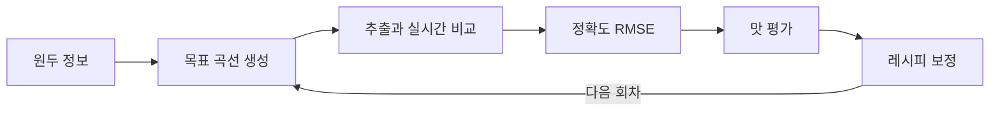

# DripDraw

[](https://github.com/kmin-k/DripDraw_Hongik/actions/workflows/ci.yml)

**같은 맛을 다시 내고, 내 취향으로 맞춰 가는 핸드드립 가이드.**

원두 정보로 목표 추출 곡선을 만들고, 블루투스 저울로 재는 실제 곡선과 실시간으로 비교해 정확도를 수치로 보여줍니다. 추출이 끝나면 맛 평가를 받아 다음 레시피를 보정합니다.

- 서비스: https://dripdraw.store
- 홍익대학교 컴퓨터공학과 졸업 프로젝트

## 해결하려는 문제

핸드드립은 같은 원두, 같은 레시피로 내려도 맛이 달라집니다. 물을 언제 얼마나 부었는지 남지 않아 원인을 알 수 없고, 맛이 아쉬워도 무엇을 바꿔야 할지 감에 의존하게 됩니다.

DripDraw는 추출을 **곡선 데이터**로 다룹니다.

- **재현성**: 목표 곡선을 따라 붓고, 얼마나 정확했는지 수치로 확인합니다.
- **취향 보정**: 맛 평가를 온도·유량·물 비율 조정으로 바꿔 다음 레시피에 반영합니다.



## 주요 기능

| 기능 | 설명 |
|---|---|
| 레시피 생성 | 원두량·음용 방식·로스팅·산지·가공 방식·분쇄도로 물 온도, 물량, 주수 시점을 계산합니다 |
| 실시간 추출 | 목표 곡선과 실측 곡선을 겹쳐 그리고, 다음 주수 시각과 목표 무게, 정확도를 실시간으로 보여줍니다 |
| 자유 추출 | 목표 없이 내리고 기록합니다. 마음에 든 추출은 손떨림을 제거해 다음 목표로 저장합니다 |
| 맛 평가와 보정 | 신맛·쓴맛·농도 평가로 새 레시피를 만들고, 무엇을 왜 바꿨는지 표와 곡선으로 보여줍니다 |
| 분쇄도 측정 | 마커 옆에 뿌린 원두 가루 사진에서 입자 크기(D50)를 계산해 레시피 입력으로 넘깁니다 |
| 기록 | 추출 곡선과 정확도, 맛 평가를 남기고 레시피별 정확도 추이를 봅니다 |

추출 중에는 화면이 꺼지지 않고, 저울이 끊기면 자동으로 다시 연결합니다. 드리퍼를 들어 올리면 그 시점까지 기록을 저장하고 추출을 끝냅니다. 앱(PWA)으로 설치해 쓸 수 있습니다.

## 시스템 구성

```text
Felicita Arc ──BLE──> React ──> 실시간 그래프·정확도
                        │
                        └──REST──> FastAPI ──> PostgreSQL
                                   ├─ Rule Engine
                                   ├─ Feedback Engine
                                   ├─ Brew Records
                                   └─ Vision Service
```

두 경로를 분리한 것이 설계의 핵심입니다.

- **실시간 경로**: 저울 → 브라우저 → 화면. 초당 약 9회 들어오는 무게 데이터는 지연과 장애 지점을 줄이기 위해 서버를 거치지 않습니다.
- **비실시간 경로**: 브라우저 → FastAPI. 레시피 계산, 기록 저장, 보정, 이미지 분석을 담당합니다.

계산 규칙은 백엔드 한 곳에만 둡니다. 저장되는 정확도도 브라우저가 보낸 값이 아니라 서버가 다시 계산한 값입니다.

## 핵심 알고리즘

**목표 곡선 (Rule Engine)**
로스팅·산지·가공 방식으로 물 온도와 유량을 정하고, 4번의 주수를 로스팅별 고정 간격으로 배치합니다. 규칙과 근거는 [Rule Table](docs/rule-table.md)에 있습니다.

**정확도 (RMSE)**
실측 시각마다 목표 곡선을 선형 보간해 물량 차이의 RMSE를 구합니다. 화면 표시용 프론트 구현과 저장용 서버 구현은 공유 기준값 테스트로 일치를 강제합니다.

**맛 보정 (Feedback Engine)**
농도는 물 비율만, 신맛·쓴맛은 온도·유량·분쇄도만 조정해 두 축이 충돌하지 않습니다. 값은 상·하한 안에서만 움직이고, 신맛과 쓴맛이 함께 강하면 조정 대신 분쇄 균일성 확인을 안내합니다. 조정 때문에 주수가 간격을 넘으면 그 조정을 빼고 이유를 알려 줍니다.

**분쇄도 측정 (Vision)**
ArUco 마커로 실제 크기를 환산하고 호모그래피로 원근을 보정합니다. 조명 보정과 이진화 후 watershed로 붙은 입자를 분리해 부피 가중 D50을 구합니다. 접근법은 [coffeegrindsize](https://github.com/jgagneastro/coffeegrindsize)를 참고해 OpenCV로 재구현했습니다.

**저울 연동 (BLE)**
공식 API가 없는 Felicita Arc의 패킷을 실물 hex dump로 분석해 연동했습니다. 형식과 명령은 [BLE 프로토콜](docs/scale-protocol.md)에 있습니다.

## 기술 스택

| 영역 | 기술 |
|---|---|
| Frontend | React, TypeScript, Vite, Tailwind CSS, Recharts, PWA |
| 저울 연동 | Web Bluetooth API, Felicita Arc |
| Backend | Python, FastAPI, SQLAlchemy, Alembic |
| Vision | OpenCV |
| DB | PostgreSQL (배포), SQLite (로컬 개발) |
| Infra | AWS EC2, Docker Compose, Caddy, GitHub Actions |

## 지원 환경과 제약

- 저울 연결은 **Web Bluetooth를 지원하는 Chrome·Edge(PC, 안드로이드)** 에서 됩니다. iOS는 지원하지 않습니다.
- 맛 보정 폭은 실사용으로 조정해 가는 휴리스틱입니다.
- 분쇄도 값은 촬영 조건에 따라 달라지므로 절대값이 아닌 상대 가이드로 봅니다.
- 오프라인은 지원하지 않습니다.

## 프로젝트 구조

```text
backend/
  app/routers/     API 엔드포인트
  app/services/    규칙 엔진, 보정, RMSE, 곡선 다듬기, 분쇄도 분석
  app/models.py    DB 모델
  migrations/      Alembic 마이그레이션
  tests/
frontend/
  src/ble/         Felicita Arc 연동, 패킷 파싱
  src/lib/         추출 세션, RMSE, API 클라이언트
  src/pages/       화면
  public/          PWA 파일, 분쇄도 측정용 마커
deploy/            Caddy 설정
docs/              설계 문서
tools/             저울 패킷 분석, 마커·아이콘 생성 도구
```

## 로컬 실행

필요 버전은 Node 24, Python 3.13입니다. 백엔드와 프론트를 각각 다른 터미널에서 띄웁니다.

**백엔드** — http://localhost:8000/docs (Swagger)

```bash
cd backend
python -m venv .venv
.venv\Scripts\activate
pip install -r requirements-dev.txt
uvicorn app.main:app --reload
```

**프론트엔드** — http://localhost:5180

```bash
cd frontend
npm install
npm run dev
```

`/api`와 `/health` 요청은 Vite가 8000번으로 넘겨 줍니다. DB 구조는 서버가 켜질 때 자동으로 최신으로 맞춥니다.

**데모 데이터** — 기존 데이터를 **전부 지우고** 새로 채웁니다.

```bash
cd backend
python -m app.seed
```

## 배포

Docker Compose로 DB, 백엔드, 웹 서버(Caddy)를 함께 띄우고 HTTPS는 Caddy가 자동으로 발급합니다. 절차와 운영 방법은 [배포 문서](docs/deploy.md)에 있습니다.

```bash
copy .env.example .env
docker compose up -d --build
```

`.env`의 `DB_PASSWORD`와 `ADMIN_PASSWORD_HASH`를 채운 뒤 실행합니다.

## 개발 규칙

자세한 내용은 [협업 가이드](CONTRIBUTING.md)에 있습니다.

**브랜치**

- `main`은 릴리스용 보호 브랜치입니다. 직접 작업하지 않습니다.
- `dev`가 통합 브랜치입니다. `dev`에서 `feature/<작업명>`, `fix/<작업명>`, `docs/<작업명>`으로 분기하고 PR을 `dev`로 보냅니다.
- 한 브랜치에는 한 가지 목적만 담습니다.

**커밋 메시지**

```text
feat: 추출 중 화면 꺼짐 방지
fix: 기록 시각을 UTC로 응답
perf: 목록 API에서 실측 곡선 조회 제외
test: 가짜 저울로 추출 흐름 시나리오 테스트
docs: 배포 절차와 운영 방법 정리
refactor: 동작 변경 없는 구조 개선
chore: 빌드·설정·도구 변경
```

**설계 원칙**

- 실시간 무게 데이터는 서버를 거치지 않습니다.
- 곡선 계산과 보정 규칙은 백엔드에만 둡니다. 프론트 계산은 BLE 파싱과 실시간 RMSE 표시뿐입니다.
- RMSE는 프론트(`lib/rmse.ts`)와 서버(`services/rmse.py`)를 항상 함께 고칩니다.
- 계산 상수는 `backend/app/services/constants.py` 한 파일에 둡니다.
- 시뮬레이션 모드는 만들지 않습니다. 가짜 저울은 테스트에서만 씁니다.

**변경할 때 함께 고칠 것**

| 바꾸는 것 | 함께 고칠 것 |
|---|---|
| DB 모델 | Alembic 마이그레이션을 같은 커밋에 넣습니다 |
| API·저장 구조 | [API 명세](docs/api.md), [ERD](docs/erd.md), 테스트 |
| 계산 규칙 | [Rule Table](docs/rule-table.md), 회귀 테스트 기준값 |

`.env`, DB 파일, 빌드 결과물, 개인 IDE 설정은 커밋하지 않습니다.

**검증**

PR과 `dev`·`main` push마다 GitHub Actions가 아래 명령을 실행합니다. 올리기 전에 로컬에서 먼저 돌립니다.

```bash
cd backend
ruff check .
ruff format --check .
pytest
```

```bash
cd frontend
npx tsc --noEmit
npm run lint
npx prettier --check src
npm test
npm run build
```

## 문서

| 문서 | 내용 |
|---|---|
| [협업 가이드](CONTRIBUTING.md) | 브랜치, 커밋, PR, 개발 환경, DB 구조 변경 |
| [시스템 아키텍처](docs/architecture.md) | 실시간·비실시간 경로와 책임 분리 |
| [API 명세](docs/api.md) | 엔드포인트별 요청·응답 |
| [데이터 모델](docs/erd.md) | 테이블과 설계 근거 |
| [Rule Table](docs/rule-table.md) | 목표 곡선과 보정 규칙 |
| [BLE 프로토콜](docs/scale-protocol.md) | Felicita Arc 패킷과 명령 |
| [배포](docs/deploy.md) | Docker 구성과 운영 |
| [로드맵](docs/roadmap.md) | 데모 시나리오, 개발 단계, 리스크 |

## 팀

김강민 · 성지훈 · 정회진
